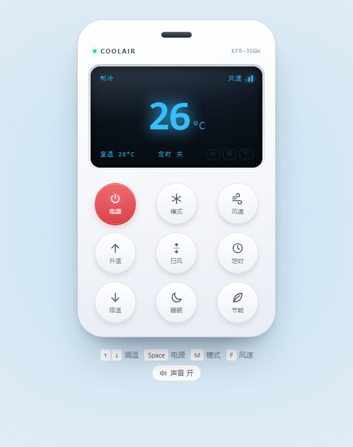
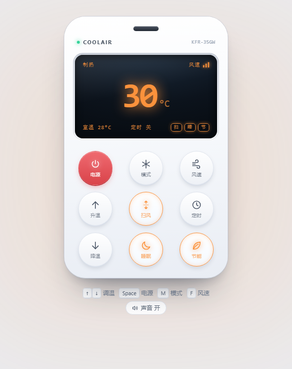

<div align="center">

# 空调遥控器 · AC Remote

_一个纯前端的拟物空调遥控器 —— 单文件、零依赖、双击就能用_

[](./LICENSE)
[]()
[]()
[]()
[]()


&nbsp;&nbsp;


<sub>左：制冷模式 · 右：制热模式（全局主题色随模式联动）</sub>

</div>

---

## 简介

打开一个 HTML 文件，得到一个手感真实的空调遥控器。没有构建步骤、没有包管理器、没有 CDN 请求，全部逻辑与样式都封装在单个 `index.html` 中，拷到 U 盘里也能跑。

界面刻意做成实体遥控器的样子：红外发射窗、电源指示灯、带玻璃反光的液晶屏、按下会下沉的圆形按键。切换模式时，制冷偏冷蓝、制热偏暖橙，整个页面会跟着一起变色。

## 功能特性

- **五种模式**：制冷 / 除湿 / 送风 / 制热 / 自动，循环切换，每种模式有独立的主题色
- **十六至三十度调温**：带弹跳动画，支持长按连续调节，到达边界会响提示音而不是静默失灵
- **四档风速**：自动 / 低风 / 中风 / 高风，液晶屏上用三根渐高竖条实时指示，自动档走呼吸动画
- **扫风、定时、睡眠、节能**：定时支持关 / 0.5 / 1 / 2 / 3 / 4 / 5 / 6 / 8 / 10 / 12 小时，各项状态在屏幕右下角以小旗标点亮
- **合成按键音**：用 Web Audio API 实时生成，不加载任何音频文件；电源键是双音，开机与关机的音高相反
- **全局主题联动**：一个 CSS 变量同时驱动液晶屏文字色、温度辉光、按键激活色与整页环境光，过渡时长 1 秒
- **键盘全可控**：方向键调温、空格开关机，触发时对应按键会播放按压动画
- **零依赖自适应**：无框架、无字体请求，窄屏自动收缩尺寸，手机上也能正常使用

## 快速开始

### 直接打开

下载 `index.html`，双击即可。就这一步。

### 从源码运行

```bash
$ git clone https://github.com/iCxin/air-conditioner-remote.git
$ cd air-conditioner-remote

# 方式一：直接打开
$ start index.html          # Windows
$ open index.html           # macOS

# 方式二：起个本地服务（可选，直接打开已足够）
$ python -m http.server 8000
```

预期输出：浏览器打开页面，显示一台白色遥控器，屏幕亮起「制冷 26 °C」。

### 嵌入已有项目

`index.html` 中的 `<style>`、`<main>`、`<script>` 三块可以整体搬进任何页面，彼此不依赖外部资源，也不会污染全局样式——所有样式都限定在遥控器自身的类名下。

## 操作说明

### 按键

| 按键 | 行为 |
| --- | --- |
| 电源 | 开关机。关机后液晶屏淡出、指示灯熄灭，页面环境光一并转灰 |
| 模式 | 制冷 → 除湿 → 送风 → 制热 → 自动 循环 |
| 风速 | 自动 → 低风 → 中风 → 高风 循环 |
| 升温 / 降温 | 16–30 °C 步进 1 °C；长按 0.46 秒后进入连续调节 |
| 扫风 | 导风板上下扫风开关 |
| 定时 | 按 关 / 0.5 / 1 / 2 / 3 / 4 / 5 / 6 / 8 / 10 / 12 小时循环 |
| 睡眠 | 睡眠模式开关 |
| 节能 | 节能模式开关 |

关机状态下按任意功能键会自动开机，与实体遥控器的唤醒行为一致。

### 键盘

| 按键 | 功能 | 按键 | 功能 |
| --- | --- | --- | --- |
| <kbd>↑</kbd> <kbd>↓</kbd> | 调温 | <kbd>S</kbd> | 扫风 |
| <kbd>Space</kbd> / <kbd>Enter</kbd> | 电源 | <kbd>T</kbd> | 定时 |
| <kbd>M</kbd> | 模式 | <kbd>N</kbd> | 睡眠 |
| <kbd>F</kbd> | 风速 | <kbd>E</kbd> | 节能 |

## 设计说明

### 主题色如何联动全局

五种模式各自对应一个色值，切换时只做一件事——把它写进根元素的自定义属性：

```js
document.documentElement.style.setProperty('--accent', MODES[state.mode].color);
```

液晶屏文字、温度辉光、激活按键的描边、以及覆盖整页的那片 150 px 模糊光斑，全部引用 `var(--accent)`。所以换主题不需要逐处改样式，颜色变量一改，1 秒过渡内整页完成换装。

温度辉光用 `filter: drop-shadow(0 0 13px var(--accent))` 实现，而不是 `text-shadow`——后者需要给颜色附加透明度，只能靠 `color-mix()` 从变量里派生，而 `drop-shadow` 直接吃变量，兼容面更宽。

### 液晶屏质感

屏体是外层浅色边框加内层 `radial-gradient` 深色底的组合，`inset` 阴影制造凹陷感，再用一个 `::after` 伪元素铺一层斜向白色渐变，模拟玻璃反光。关机时屏内内容整体降低不透明度并加 4 px 模糊，而不是直接消失，观感更接近真实液晶屏的余晖。

## 文件结构

```
air-conditioner-remote/
├── index.html                      # 全部实现，可直接运行
├── air-conditioner-remote.html     # 同一文件的副本，保留原文件名便于识别
├── docs/
│   ├── screenshot-cool.png         # 制冷模式截图
│   └── screenshot-heat.png         # 制热模式截图
├── LICENSE
└── README.md
```

## FAQ

<details>
<summary>能真的控制空调吗？</summary>

不能。浏览器无法发射红外信号，这是一个交互与视觉的模拟实现。要接入真实空调，需要后端配合红外发射硬件（如 ESP8266 红外模块），由页面发送指令、硬件负责发射。

</details>

<details>
<summary>点了按键但没有声音？</summary>

浏览器的自动播放策略要求页面先有过用户交互才能播放音频。随便按一下任意按键即可激活；如果仍然没有声音，检查页面底部「声音」开关是否处于关闭状态。

</details>

<details>
<summary>想改默认温度或默认模式？</summary>

在 `index.html` 中搜索 `var state = {`，初始状态集中在这里：

```js
var state = {
  power: true,
  mode: 0,      // 0 制冷 1 除湿 2 送风 3 制热 4 自动
  temp: 26,
  fan: 0,       // 0 自动 1 低风 2 中风 3 高风
  // ...
};
```

</details>

<details>
<summary>浏览器支持情况？</summary>

未使用任何实验性或近期才标准化的特性。页面依赖的能力只有 CSS 自定义属性、CSS Grid、`pointerdown` 指针事件与 Web Audio API 四项，最早一项（自定义属性）在 2016–2017 年就已进入各主流浏览器稳定版，因此近年任何版本的 Chrome、Edge、Firefox、Safari 都可正常渲染。IE 不支持，也不需要支持。

音效走 Web Audio API，`AudioContext` 创建失败时会被 `try/catch` 吞掉，不会影响其余交互。

</details>

## License

[MIT](./LICENSE) © 2026 iCxin
